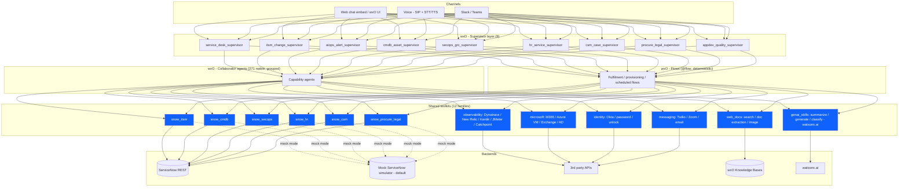

# ServiceNow Now Assist Catalog → watsonx Orchestrate (wxO) Adoption Plan

**Status:** PLAN ONLY (`ANALYSIS_ONLY`). No wxO artifact has been generated, imported, or chat-tested yet.
**Inputs analysed:** `to build/agents.md` (1,461 lines), `workflows.md` (537), `autonomous_workforce.md` (8), `apps.md` (478).
**Machine-readable inventory:** [`inventory.csv`](inventory.csv) (one row per unique item, with proposed wxO class and tool families).
**ADK baseline in workspace:** `github/ibm-watsonx-orchestrate-adk-main` reports `__version__ = "2.14.0"`. The `wxo-solution-compiler` skill targets 2.15.0. Pin the version in Sprint 0 and re-verify CLI semantics.
**Local environment:** the `orchestrate` CLI is **not installed** on this machine (`which orchestrate` returned nothing). This blocks the "Definition of Done" (`orchestrate agents list` + chat test) until Sprint 0 completes.

---

## 1. What the source files actually are

All four files are a **catalog listing of ServiceNow Now Assist / AI Agent Studio assets** (source tag `ServiceNow - OOTB` or `ServiceNow - Now on Now`). Each entry is only **name + one-line description**. There are no prompts, tool definitions, schemas, or flow logic.

Consequence, stated plainly: **these agents cannot be "imported" into wxO.** Adoption means **re-implementing each capability as a wxO-native agent / tool / flow**, with ServiceNow remaining the system of record that the tools call over REST. Behaviour will be derived from the one-line descriptions plus ServiceNow's public table/API model; it will not be a byte-for-byte clone of the OOTB agents.

| File | Raw count | Unique after de-dup | Domains |
|---|---|---|---|
| `agents.md` | 364 | **336** | IT 198, CRM 65, App Dev 27, HR 26, Security & Risk 25, Finance & Supply Chain 23 |
| `workflows.md` | 130 | **124** | IT 62, CRM 32, Security 12, HR 9, App Dev 8, Finance 7 |
| `autonomous_workforce.md` | 2 | 2 | AIOps AI Specialist, L1 Service Desk AI Specialist |
| `apps.md` | ~120 | – | Full ServiceNow scoped applications (Animal Rescue, Tax Portal, etc.) |

21 agent names recur across domains (e.g. *KB Summarization* appears 6×, *Record management AI agent* 3×). They are built **once** and attached to multiple supervisors.

### 1.1 Classification of the 462 unique items

| Class | Count | wxO mapping |
|---|---|---|
| `NATIVE_AGENT` | 271 | `kind: native`, `style: react_core`, 1 YAML each |
| `FLOW_OR_SUPERVISOR` | 125 (123 workflows + 2 workers) | Supervisor agent (reasoning-led) **or** `@flow` (deterministic) – decision rule in §3 |
| `TOOL_GENAI_SKILL` | 43 | **Not agents.** Summarization / generation skills (KB, case, chat, resolution, code, ATF test gen). Collapse into ~8 parameterized Python tools backed by `watsonx.ai` |
| `EXCLUDE_SN_PLATFORM` | 23 | Administer ServiceNow's own AI config (model provider, Guardian, translation, skill config, SHA diagnostics). No wxO equivalent; wxO has its own AI Gateway/guardrails. **Excluded** – list in `inventory.csv` |
| `apps.md` | ~120 | **Out of scope.** These are ServiceNow applications, not agents. Only relevant as *data sources* if a specific agent needs one (e.g. Customer Success Story, Test Assist). Needs your confirmation |

> The 7 voice-labelled items (password reset, account unlock, Outlook troubleshoot, catalog item request – "with voice") require the wxO **voice channel** (SIP/phone + Deepgram/ElevenLabs/Watson config). Treat as a separate wave.

---

## 2. Target architecture



### 2.1 Design decisions

1. **Manifest-driven generation, not 460 hand-written files.** One `catalog.yaml` row per item → a Python generator emits `agents/*.yaml`, `flows/*.py`, and `import-all.sh`. Hand-craft only the 12 toolkits and ~10 "gold" exemplar agents; generate the rest and review in bulk.
2. **Tools are shared by family, agents are thin.** An agent YAML is: name, description, instructions, a *subset* of 3–8 tools from its family, optional collaborators. This keeps 271 agents consistent and cheap to regenerate.
3. **Dual-mode tools (mock / live), zero code change.** Each tool reads `SNOW_MODE=mock|live`. Mock mode calls a bundled ServiceNow simulator (synthetic incidents, changes, CIs, users, cases – Faker seed 42, `@example.com`). Live mode uses a wxO **connection** (`service-now`, `basic_auth` or `oauth` per ADK example `customer_care/tools/servicenow/*.py`, pattern `connections.basic_auth("service-now")`). Satisfies the "works offline" non-negotiable.
4. **Supervisors, not a flat 271-agent roster.** A single agent with hundreds of collaborators will route poorly. Group into 9 domain supervisors; each fronts roughly 15–45 collaborators. The exact collaborator ceiling that keeps routing accurate is **unknown** – measure in Sprint 1 with the evaluation framework, then split supervisors further if routing accuracy falls below target.
5. **Agent vs flow decision rule** (applied per workflow row):
   - Open-ended diagnosis, planning, Q&A, conversation → **supervisor/native agent**.
   - Fixed sequence, approvals, provisioning, scheduled or event-triggered, fan-out over lists (e.g. *Software Request Fulfillment*, *Okta Enterprise Application Access*, *Schedule Interviews*, *Coordinate supplier onboarding*) → **`@flow`** with agent/tool nodes.
   - Hybrid (e.g. *AIOps AI Specialist Workflow*, *Manage alerts autonomously*) → supervisor agent that calls a flow-as-tool for the deterministic remediation stage.
6. **GenAI "skills" become tools, not agents** (43 items → `summarize_record(kind=incident|case|kb|chat|…)`, `generate_kb_article`, `generate_resolution_notes`, `code_assist(mode=explain|comment|refactor|generate)`, `generate_tests(kind=atf|unit|functional)`). Inference through `watsonx.ai` via `ibm-watsonx-ai` – **invoke the `ibm-watsonx-ai` skill before writing this toolkit**.
7. **Default agent LLM:** `groq/openai/gpt-oss-120b` (per house default). Complex reasoning agents may override; verify model availability with `orchestrate models list` in the target env.
8. **Knowledge bases:** 1 per domain (ITSM KB, HR policy, security/regulatory, CSM KB, procurement/contract) seeded with synthetic documents; used by "Next best action", "Search Q&A", "Knowledge", "Regulatory", "Policy" agents.
9. **Governance:** every agent gets a row in a governance declaration (owner, risk class, allowed/prohibited actions, approval requirement). Tools are tagged `ToolPermission.READ_ONLY` vs `READ_WRITE`; all `READ_WRITE` tools on security, HR, finance, and provisioning agents require a human-approval step (flow `user_flow` / confirm in instructions). Optional registration in watsonx.governance later.

---

## 3. Tool inventory (the real build effort)

Tool-family tallies come from keyword tagging in `inventory.csv` (an item can map to up to 3 families; counts are indicative, not exact).

| # | Toolkit | Items touching it | Representative tools (READ / WRITE) | Backend / connection |
|---|---|---|---|---|
| 1 | `snow_itsm` | ~307 | `get_record`, `search_records`, `update_record` (W), `create_incident` (W), `get_sla`, `find_similar_incidents`, `link_major_incident` (W), `get_change`, `check_change_conflicts`, `schedule_change` (W), `get_approvals`, `act_on_approval` (W), `list_catalog_items`, `submit_catalog_request` (W) | ServiceNow `table`/`now` APIs, conn `service-now` |
| 2 | `snow_cmdb` | ~39 | `search_ci`, `get_ci_ownership`, `cmdb_health`, `set_principal_class` (W), `reclamation_candidates`, `remove_allocation` (W), `license_availability` | ServiceNow CMDB/SAM APIs |
| 3 | `snow_secops` | ~55 | `get_security_incident`, `enrich_observable`, `kev_feed` (CISA), `vuln_exposure`, `create_remediation_task` (W), `grc_issue` (W), `regulatory_alert` | ServiceNow SecOps/GRC + CISA public JSON |
| 4 | `snow_hr` | ~30 | `get_hr_case`, `create_requisition` (W), `find_interview_slots`, `send_interview_invite` (W), `build_ramp_plan` (W), `tuition_policy_check` | ServiceNow HRSD |
| 5 | `snow_csm` | ~96 | `get_case`, `triage_case`, `verify_customer`, `lead_*` (W), `renewal_analysis`, `billing_lookup`, `create_work_order` (W) | ServiceNow CSM / Sales & Order Mgmt |
| 6 | `snow_procure_legal` | ~21 | `product_recommend`, `track_procurement`, `supplier_validate`, `supplier_activate` (W), `extract_contract_metadata`, `legal_category_predict` | ServiceNow S2P / Legal |
| 7 | `observability` | ~35 | `dynatrace_problem`, `newrelic_impact`, `kentik_flow`, `jmeter_compare`, `catchpoint_compare`, `alert_get/ack/assign` (W) | Dynatrace / New Relic / Kentik / JMeter / Catchpoint REST – each needs its own wxO connection |
| 8 | `microsoft` | ~14 | `m365_group_members` (W), `azure_vm_status`, `azure_vm_power` (W), `azure_vm_snapshot` (W), `exchange_search_delete` (W), `ad_group_add/remove` (W) | Microsoft Graph / Azure ARM / AD – `oauth` connections |
| 9 | `identity` | ~12 | `okta_assign_app` (W), `password_reset_link` (W), `unlock_account` (W) | Okta / ServiceNow catalog |
| 10 | `messaging` | ~11 | `send_email` (W), `send_sms_twilio` (W), `zoom_channel_message` (W) | SMTP/Graph, Twilio, Zoom |
| 11 | `web_docs` | ~26 | `web_search`, `web_automate` (browser tool – see risk R5), `extract_document`, `redact_document`, `analyze_image` | wxO native web search / doc processor, watsonx.ai vision (Llama 4 Maverick) |
| 12 | `genai_skills` | 43 skill rows | `summarize_record`, `generate_kb_article`, `generate_resolution_notes`, `code_assist`, `generate_tests` | `watsonx.ai` |

Expected output: **~150–200 distinct tools**, most of them thin REST wrappers over a handful of ServiceNow tables. This is the dominant cost; the 271 agent YAMLs are mechanical once the toolkits exist.

---

## 4. Agent-to-supervisor grouping (domain × capability)

| Supervisor | Collaborators (examples from the catalog) | Flows |
|---|---|---|
| `service_desk_supervisor` (L1 Service Desk AI Specialist) | Request status, Approval assistance, Prioritize work, Password reset (voice), Account unlock (voice), Outlook troubleshoot (voice), Find catalog item, Universal Request router, Email intent identification/executor/generator | Zero Touch Service Desk, Email Intent to Action, Universal Request Router, Software Request Fulfillment, Okta Enterprise App Access |
| `itsm_change_supervisor` | Change implementation/test/backout plans, Change risk & impact, Change conflict assessor, Change quality assessor, Schedule change, Standard change template recommender, Problem investigator, Incident triager, Categorize incident, Classify service & CI, Link major incident, Post-incident review, Issue trend analysis | Create standard change, Assess conflicts, Schedule a change, Generate change plans, Investigate IT problems, Generate post-incident reviews |
| `aiops_alert_supervisor` (AIOps AI Specialist) | Alert handling, Alert information retrieval, Alert impact summary, Dynatrace/New Relic/Kentik analysis, MID Server resolver, Wireless resolver, Linux VM assist, Infra degradation, DEX diagnosis/resolution | AIOps AI Specialist Workflow, Manage alerts autonomously, Analyze alert impact, Triage & analyze alerts, DEX issue workflow |
| `cmdb_asset_supervisor` | CI ownership, CMDB Health, Data certification, Principal CI classes, CMDB data manager, Repair/Evaluate asset, Software reclamation, License availability | CMDB Governance, Search CMDB, CI creator, Software Reclamation Process, Help repair hardware assets |
| `secops_grc_supervisor` | Security incident retrieval/resolution/wrap-up, Observable analysis, Phishing (Exchange), CISA KEV analyzer, Vulnerability exposure, Regulatory alert agents, Risk suggestion, GRC issue agents, Digital Cyber Hygiene Manager, Zscaler, Adaptive auth | Resolve/Close security incident, Assess vulnerability exposure, Regulatory analysis/action plans, SIR shift handover, Cyber hygiene monitoring |
| `hr_service_supervisor` | Job requisition, Slot finder, Interview email/invite/context, Ramp-up plan (gather/generate/review), HR case planner, Criticality detection, Tuition reimbursement (3 agents), Health & safety (2 agents), Conversation management | Schedule Interviews, Onboarding ramp-up, Resolve HR cases, Tuition flows, Safety incident actions |
| `csm_case_supervisor` | Complaint intake/triage/research, Case context gatherer, Customer verifier, Escalation handler, Billing collectors, Network ticket/remediation agents, Success health/risk/insights, Renewal analysis, Lead agents (Outreach, Disinterest, Appointment, Inbound email, Engagement mgr), Partner agents, Telecom service repair/test | Triage cases, Accelerate complaint handling, Nurture new leads, Monitor engagement health, Support renewals, Partner Deal/Lead/PRL Assist, Test & repair telecom |
| `procure_legal_supervisor` | Procurement recommendation/tracking/inquiry, Supplier doc strategy/validator/steward/approval, Contract record handler, Lead-time calculator, Contract metadata extractor, Legal transfer, Order enrichment | Coordinate supplier onboarding, Manage contract repository, Triage legal requests, Conversational procurement, Contract search |
| `appdev_quality_supervisor` | AQE (4 agents), Factory (4 agents), OneClick JMeter/Catchpoint/Consolidated, ACC diagnostic, Enrollment/Content recommendation, Artifact creation, Alert automation | AQE ATF generation, Create stories, OneClick Report, Factory intake, ACC Diagnostic, LEAP |

(Full per-item assignment is produced by the generator from `inventory.csv` + a `supervisor` column added in Sprint 0.)

---

## 5. Delivery plan (sprints)

Estimates are effort guidance for a small team (1–2 engineers + AI-assisted generation); not commitments.

| Sprint | Output | Exit criteria (evidence) |
|---|---|---|
| **0 – Foundations (2–3 d)** | Install `orchestrate` CLI/ADK (pin 2.14.x or 2.15.x), Developer Edition running, active env. Repo layout, `catalog.yaml` schema, generator skeleton, ServiceNow mock simulator, `ibm-watsonx-ai` + `watsonx-orchestrate` skills loaded | `orchestrate --version`, `orchestrate env list`, simulator `/health` 200 |
| **1 – Vertical slice (1 wk)** | Toolkit `snow_itsm` (+`genai_skills` core). **10 gold agents** + `service_desk_supervisor` + 2 flows (e.g. Zero Touch Service Desk, Universal Request Router). Evaluation harness (`orchestrate evaluations`) with ≥30 test cases; routing accuracy baseline | `orchestrate agents list` shows all; `orchestrate chat ask` transcript for each; eval report; **go/no-go on supervisor sizing** |
| **2 – IT core (1–2 wk)** | `itsm_change_supervisor`, `aiops_alert_supervisor`, `cmdb_asset_supervisor`; toolkits 1, 2, 7, 8, 10; ~110 IT agents + ~45 flows; AIOps AI Specialist + L1 Service Desk workers end-to-end | Each supervisor passes eval ≥ agreed routing/tool-call thresholds; AIOps scenario runs alert → investigate → remediate in mock mode |
| **3 – Security, HR, Finance (1–2 wk)** | Toolkits 3, 4, 6, 9; `secops_grc`, `hr_service`, `procure_legal` supervisors; knowledge bases; approval gates on all W tools | Negative tests: write tool refused without approval |
| **4 – CRM + AppDev (1–2 wk)** | Toolkits 5, 11; `csm_case`, `appdev_quality` supervisors; partner/lead/telecom flows; 3rd-party connections | Eval pass; remaining YAMLs generated |
| **5 – Voice & channels (3–5 d)** | 4 voice-labelled agents on the voice channel; optional Slack/Teams | Phone/web-voice test recording |
| **6 – Live hardening (ongoing)** | Flip `SNOW_MODE=live` against a ServiceNow PDI; wxO connections; AgentOps tracing; red-teaming eval; governance declaration | One end-to-end live ticket created and read back |

**Definition of done per wave** (from house checklist): artifacts on disk (`agents/*.yaml`, `tools/*.py`, `flows/*.py`, `import-all.sh`) → imported in dependency order (connections → models → KBs → tools → toolkits → collaborators → supervisors) → `orchestrate agents list` evidence → `orchestrate chat ask` test → `orchestrate agents deploy`. Orchestrate must **not** be used only as an inference endpoint.

### 5.1 Proposed repository layout
```
wxo-servicenow-catalog/
├── catalog/catalog.yaml            # generated from inventory.csv + supervisor/tool-family mapping
├── generator/gen_agents.py         # catalog -> agents/*.yaml, flows/*.py, import-all.sh
├── simulator/                      # mock ServiceNow (FastAPI, Faker seed 42)
├── toolkits/{snow_itsm,snow_cmdb,...,genai_skills}/*.py
├── agents/{supervisors,collaborators}/*.yaml
├── flows/*.py
├── knowledge_bases/*.yaml + docs/
├── connections/*.yaml              # env-var placeholders only
├── evaluations/{routing,tools,negative}/
├── scripts/{import-all.sh,verify.sh,check-compliance.sh}
└── docs/{ARCHITECTURE.md,PILOT_PLAN.md,DEMO_SCRIPT.md,README.md,GOVERNANCE.md}
```

---

## 6. Risks and honest gaps

| ID | Risk / gap | Mitigation |
|---|---|---|
| R1 | Source is name + one-liner only; behaviour is inferred | Label every generated agent `CANDIDATE_ARTIFACT`; SME review of the 10 gold agents first |
| R2 | **Not equivalent to ServiceNow OOTB agents** – they run inside Now Assist with native platform access, Guardian, ACLs. wxO re-implementations call REST under one service account | State this in client messaging; use per-user OAuth where possible; do not claim parity |
| R3 | Routing quality at hundreds of agents | Supervisor tiering + eval gating (§2.1 #4); ceiling unverified |
| R4 | `orchestrate` CLI not installed; ADK 2.14.0 vs 2.15.0 mismatch | Sprint 0 pin + `--help` verification of every command used |
| R5 | `Web automation AI agent` (clicking/form-filling on any page) has no confirmed wxO-native equivalent | Treat as `DEGRADED`: implement via a browser-tool/MCP toolkit, or defer. Flag to client |
| R6 | 3rd-party connections (Dynatrace, New Relic, Kentik, Okta, Azure, Twilio, Zoom, Catchpoint) need real credentials/tenants | Mock first; live only for tenants you can provide |
| R7 | Security/HR/Finance write actions (phishing deletion, supplier activation, AD changes) are consequential | Approval gate + `READ_WRITE` tagging + audit log; excluded from autonomous mode by default |
| R8 | Voice items require channel config and provider keys | Separate wave (Sprint 5) |
| R9 | Synthetic data only; no client ServiceNow data | Simulator + DemoBanner on any UI |
| R10 | Output volume (~460 definitions (462 items)) is unreviewable by hand | Generator + schema validation + `orchestrate ... import` dry run + spot-check sampling |

---

## 7. Decisions needed before building

1. **Scope:** all 462 (full coverage, ~7–9 weeks) vs. a priority slice (recommended: IT + AIOps + L1 Service Desk first, ~3–4 weeks)?
2. **Backend:** do you have a ServiceNow PDI / instance and credentials for live mode, or mock-only for now?
3. **wxO target:** Developer Edition (local), or a cloud/SaaS wxO tenant (URL, API key, region)? Needed for the `orchestrate agents list` evidence.
4. **`apps.md` (~120 ServiceNow apps):** confirm out of scope.
5. **Excluded 23 platform-admin items** (model provider, Guardian, translation, etc.): confirm exclusion.
6. **Voice:** is the voice channel in scope for the first release?
7. **Packaging:** wxO-only deliverable, or also a Carbon React front-end demo (per the demo-builder defaults)? If a UI is wanted, the `carbon-mcp` skill must be run first.
